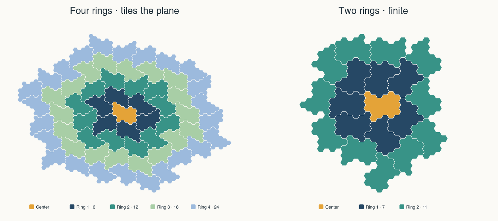

# Can a three-hexagon strip turn a three-ring shape into a four-ring non-tiler?

We tested all 761 distinct shapes obtained by the construction below. Of these, 131 tile the plane. Five of the 630 finite shapes reach two complete rings, and none reaches three. This experiment was conducted with GPT-6.2 Astra, high reasoning, in Codex.

Both shapes pictured below come from the same parent (record 63) and the same cut. Moving the inserted row sideways by one hexagon changes the result. Six copies of the shape on the left form a unit that repeats across the plane. The shape on the right stops after two rings. Gold marks the center in both drawings.



[Challenge and leaderboard](https://www.yukon.org/heesch) · [Machine-readable results](summary.json) · [Six-copy tiling certificate](six-copy-unit.json) · [Verified finite arrangement](paired-finite.heesch)

The file `summary.json` reports exact finite strict (Hc) and outer-hole-permitted (Hh) depths for this family, along with constructive tiler counts. `best-finite.heesch` is a strict lower-bound witness. `audit.jsonl` retains the per-shape evidence including the accepted geometries. `proof/` and `proof.log`, when present, give the frozen benchmark certificate attempt for the representative finite child.

Of the 761 children, 131 tile the plane. The remaining 630 have finite depths:

| Strict rings (Hc) | Outer holes allowed (Hh) | Children |
|---:|---:|---:|
| 0 | 0 | 271 |
| 0 | 1 | 161 |
| 1 | 1 | 193 |
| 2 | 2 | 5 |

There is a strict four-ring witness for the six-copy tiler in this archive. The strongest finite candidate shown is one of five tied children with exactly two strict rings. It derives from parent record 298, rotation 1, cut at y=3 and displacement (-1,1). Its digest is `74224b0032593a2940f03de7dcb3c0a373a459ba864951f67d39733f3ce07b76`. The native screen classified 685 shapes within its allowance and yielded no classification for 76. The independent audit resolved all 76. The frozen gate identified 100 Conway, eight translation, and 22 periodic tilers. An additional six-copy exact cover supplies the 131st tiling.

Parent 63 isolates the effect of the stagger. At the same y=2 cut in frame 0, displacement (-1,1) gives the six-copy tiler, whereas displacement (0,1) gives another of the five exact two-ring non-tilers. The matching finite geometry is in `paired-finite.heesch`.

## Inputs and construction

[Craig S. Kaplan's data](https://cs.uwaterloo.ca/~csk/heesch/hex/17hex_3up.txt) has SHA-256 `77e40d2966a1603b536944e6767d84dbdae9d53677965b1c525da638492a535d`. Its 570 records comprise 161 with Hc = Hh = 3, 408 with Hc = 2 and Hh = 3, and one with Hc = Hh = 4. Use all 161 exact strict-three parents. The others and any external controls are outside the family. Row numbers are one-based records in the text file.

Use axial hex coordinates with edge steps (1,0), (0,1), (1,-1) and their negatives. Rotate into each of three frames numbered 0, 1, 2, the first three matrices in the frozen hex grid orientation list. Constant y in those frames means constant y, x+y, x respectively in the original coordinates. At each integer t strictly between the minimum and maximum row, take the entire row at y=t. If it consists of exactly three consecutive cells, keep the cells with y≤t and add a translated copy of all cells with y≥t. The displacement is either (0,1) or (-1,1), the two nearest-neighbor ways to advance one row. This rigidly translates the entire upper bank and duplicates the cross-section. Reversing the moved side changes only the global translation and which of the symmetric directions describes it. No shear of an individual tile is used in the packing search. This definition excludes perimeter-only rows, partial runs inside a longer row, and arbitrary longer shifts along the cut.

155 parents contribute at least one cut. There are 437 interior three-cell sections and 874 placements of a new row: 112, 364 and 398 constructions across the three frames respectively. Every proposal has 20 distinct cells and passes the frozen edge-connectivity, hole, and span checks. Canonicalizing under translations, six rotations and six reflections leaves 761 free children. `family.json` records all origins. `check_family.py` independently regenerates the digest set in the published coordinate system, without choosing rotated frames. Six source parents have no eligible interior cross-section.

## Search and exclusions

`search.py` runs Kaplan's reference SAT solver serially through depth four with both outer-hole and isohedral tests. Its per-process CPU and memory allowances are experimental budgets. A killed process or a timeout supplies no upper bound. `stage.jsonl` retains its raw reports including shallow witnesses. `batch.py` runs a separate PySAT Minicard computation per shape. Non-tiling results are decided by this independent geometric audit rather than by trusting a native short run. `classify.py` also applies the constructive frozen tiler gate to native tilers and deep candidates.

For a fixed central tile, enumerate all orientations and all translations which reach at least one cell of its halo, excluding those overlapping it. The one-ring SAT formula covers every halo cell and forbids overlapping placements at every cell. Set R1 contains all neighbor poses which appear in any model, including surrounds with holes. An assumption check per not-yet-seen pose establishes this union.

For d≥2, a d-ring hole-agnostic patch centered at the origin fully surrounds every immediately neighboring tile through d−1 local layers. This follows by tile-contact graph distance: any tile within distance d−2 of that neighbor is within distance d−1 of the origin, so all of its edge neighbors are covered. Thus every contacting pair between first neighbors or between one of them and the center must appear, in both required orientations, among the necessary contacts R(d−1). `refine.py` eliminates placements and incompatible pairs accordingly, solves the one-ring cover again, and finds the union Rd of supported neighbors. Rd is a relaxation. An empty Rd excludes even a hole-permitted patch of depth d; a nonempty Rd alone proves no witness.

`exact.py` uses those necessary domains when a lower bound or tighter upper bound is needed. A tile at level j<d can see only placements supported by R(d−j) in its local frame. Every selected inner tile must have its halo covered by selected tiles at its own or an adjacent level. Every selected tile after the center must touch a chosen predecessor. Packing constraints prevent overlap everywhere. These clauses imply the submitted levels agree with tile-contact distances: each tile has a path back, and a shortcut across multiple levels would occupy a required halo cell without a legal occupant at the adjacent level. When a SAT model has holes at a forbidden level, the algorithm requires the perimeter tiles to change or the enclosed cells to be covered at that level. A genuine hole-free patch satisfies this implication, and each cut removes the offending model. Permitted outer holes are retained for the Hh query. Each positive returned by this solver passes the frozen verifier with strict claims, with a separate strict prefix supplied when the outer ring contains holes. The audit logs contain solver results; they are distinct from an externally checked LRAT proof of the benchmark encoder's formula.

Frozen verifier commit [947f057](https://github.com/Layr-Labs/heesch/tree/947f05720e0842d80b5119b9b88546c890111d19). Native solver commit [d12a527](https://github.com/isohedral/heesch-sat/tree/d12a527c04310fed51d522318126781e2f7ed56d). The only native build specialization is an input dispatcher for the H grid; its search headers are upstream. `downloads.sha256` pins the Debian ARM64 build dependencies and upstream source archive. Python 3.12.16 and python-sat 1.9.dev25 were used in the experiment.

## Frozen benchmark proof attempt

The official proof producer attempted F(S,3) for the row-298 finite representative in an isolated directory. Its Python encoder raised MemoryError while forming the set of geometric contact pairs under a 1,200 MiB process virtual-memory cap, before finishing the CNF or invoking the proof solver. No official LRAT, formal non-tiler gate verdict or benchmark score was produced. The retained shape in proof/best.heesch is geometry only. The independent audit establishes Hh≤2 for this child because the necessary three-ring contact set is empty, with 102, 21 and zero supported contacts at successive depths. The frozen strict witness attains two.

## Replay

Use a clean scratch directory containing the archive files. Set PYTHONPATH for the pinned verifier and python-sat. The independent audit can be repeated from the saved stage.jsonl without downloading or compiling the native solver. The native stage can be rebuilt with GCC 12 on Debian bookworm ARM64.

```sh
curl -fsSL https://cs.uwaterloo.ca/~csk/heesch/hex/17hex_3up.txt -o kaplan17.txt
sha256sum -c SHA256SUMS
export PYTHONPATH=/tmp/heesch-research-deps:/tmp/yukon-home/heesch
export PYTHONDONTWRITEBYTECODE=1
python3 generate.py
python3 check_family.py
sh source-deps.sh
python3 search.py family.json stage.jsonl --depth 4 --cpu 3
python3 batch.py
python3 report.py
sh prove-best.sh
```

When the frozen gate misses a tiler whose four-ring witness is available, `period_from_patch.py` tries HNF (Hermite normal form) lattices up to twelve copies. It accepts only a partition of all residue cells by full disjoint tile footprints. The saved periods and placements in `additional-periods.json` repeat by translation to cover the whole plane. This is constructive evidence independent of the frozen gate's search budget.

