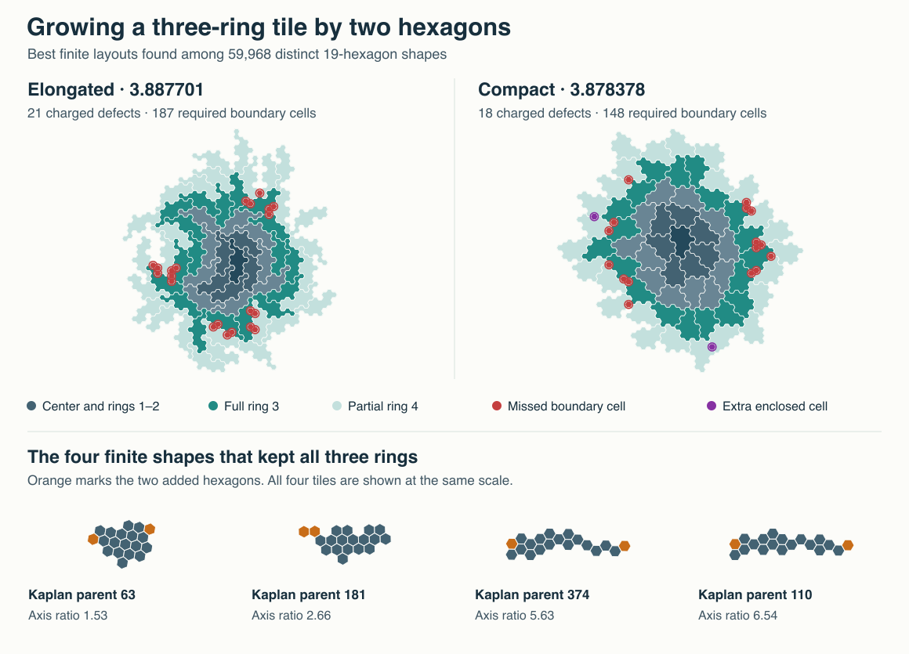

# Adding two hexagons to three-ring tiles

Four of 59,968 distinct, challenge-legal 19-hexagon shapes are finite and retain three complete rings. No finite shape in this family admits a complete fourth ring. The depth search allowed every ring to rearrange.

We started with all 161 exact-three-ring 17-hexagon parents in [Craig S. Kaplan’s catalog](https://cs.uwaterloo.ca/~csk/heesch/hex/17hex_3up.txt), added two cells at the boundary, discarded shapes with holes, and identified rotations, reflections and translations. Two additions at opposite ends and two adjacent additions at the same end are both included. The family has 66,701 legal growth routes before removing duplicates.



| 19-cell shape | Distinct shapes | At least one complete ring | Finite three-ring shapes | Best layout found |
|---|---:|---:|---:|---:|
| Elongated | 35,367 | 6,681 | 3 | 3.887701 |
| Compact | 24,601 | 2,842 | 1 | 3.878378 |

We classified shapes by the ratio of the principal-axis standard deviations of their hexagon centers, with 2 as the cutoff for elongated. Within an equal-perimeter comparison of 21,754 shapes per group, 3,992 elongated and 1,924 compact shapes completed at least one ring. Exactly one finite shape in each matched group completed three. The complete family includes two more elongated three-ring shapes. [Cohorts](cohorts.json) · [Individual outlines and growth routes](family/)

## The two best layouts

The elongated tile grows two adjacent cells at one end of parent 181. It completes three rings and covers 166 of 187 required cells in ring four, without enclosing any additional empty cells. Its verified geometry scores **727/187 = 3.887700535**. The frozen encoder reproduced the full fourth-ring formula. The full-formula DRAT check passed and two independent checkers accepted a proof on a verified subset of its clauses. The stock local grader exhausted its CakeML heap on the full formula and issued no score. [Placements and proof](elongated/) · [Stock grader log](elongated/standard-grade.log) · [Encoder comparison](reference/receipt.json)

The compact tile from parent 63 misses 16 boundary cells and encloses two more empty cells. Its credited fourth-ring fraction is 130/148. The unmodified local Yukon grader issued **3.878378**. Both fractional scores describe the best layouts we found. The proofs establish the maximum number of complete rings for each tile. [Compact placements, proof and local score](compact/) · [Four exact layout scores](drawn-scores.json)

## Check the results

The [contact screen](screen/summary.json) left 1,955 shapes potentially capable of four rings. Explicit repeating units prove that 1,948 tile the plane. The remaining seven cannot complete a fourth ring. The archive includes the [tiling certificates and finite-shape decisions](deep/), [all four finalist proofs](strict/depth-proofs/), and [the highest-scoring placements](mobile/finalists/). These findings concern this two-cell growth family. Related challenge work covers [growth from four-ring seeds](https://github.com/Layr-Labs/heesch/discussions/93) and [mutations of high-ring tiles](https://github.com/Layr-Labs/heesch/discussions/95).

For a quick check, run the first two commands from this directory. The second rebuilds the class comparison from the per-shape tables. The deeper replay below uses Linux, Python 3.12 with python-sat 1.9.dev25, and the [frozen Yukon checkout](https://github.com/Layr-Labs/heesch/tree/947f05720e0842d80b5119b9b88546c890111d19) with its lrat-check binary built.

```sh
shasum -a 256 -c SHA256SUMS
python3 compare.py

# Set FROZEN to the absolute path of the frozen challenge checkout.
export PYTHONPATH="$PWD/support:$FROZEN"
export PYTHONHASHSEED=0
python3 deep/verify.py family/shapes.tsv.gz screen/results.tsv.gz deep
python3 strict/depth-proofs/replay.py strict/depth-proofs "$FROZEN/tools/bin/lrat-check" \
  --four-ring-control support/control-four.heesch --three-ring-witnesses deep/witnesses
```

The first replay checks the repeating units, verifies the saved placements and reconciles all deep-search IDs. The second regenerates all 21 archived formulas, checks their proof bytes, and exercises a known four-ring positive control. The [family generator](family/generate.py) accepts the downloaded Kaplan catalog and a fresh output directory. See the upstream [challenge specifications](https://github.com/Layr-Labs/heesch/tree/947f05720e0842d80b5119b9b88546c890111d19/docs) for scoring and proof formats.
